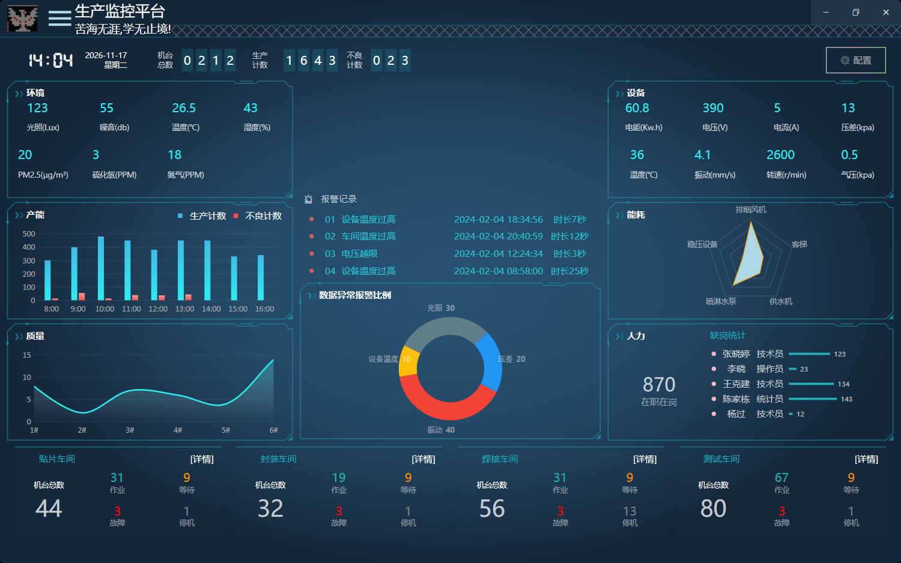
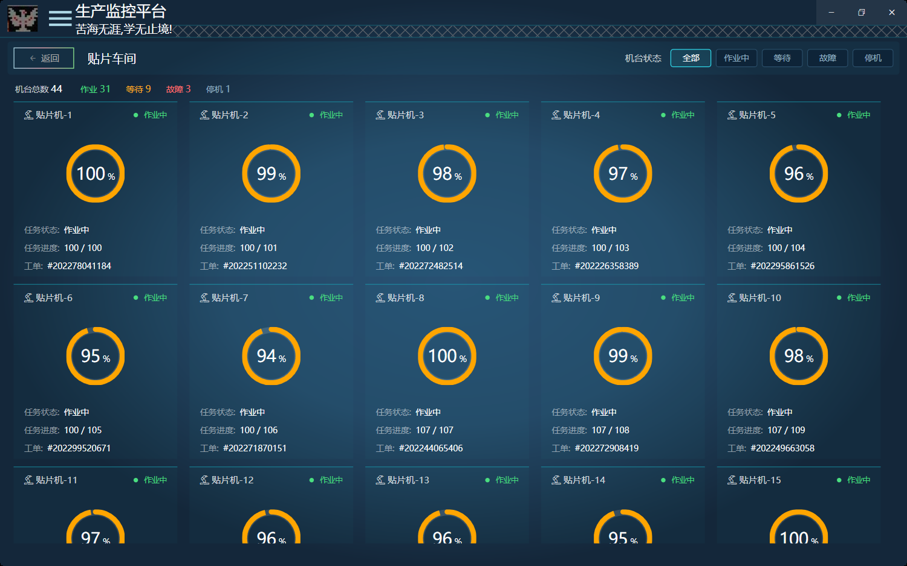
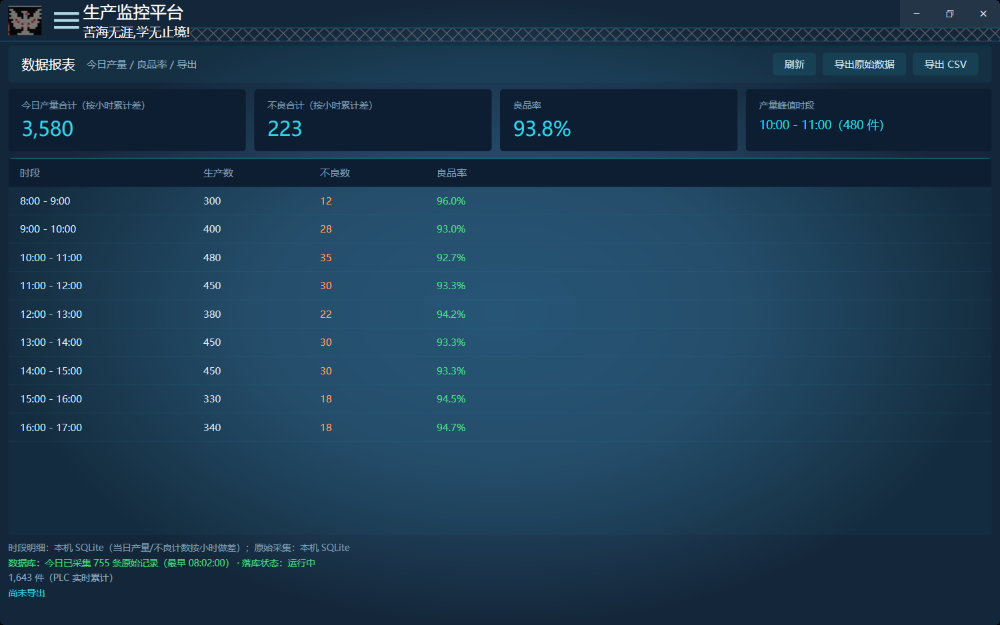
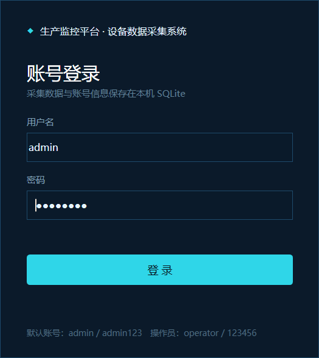
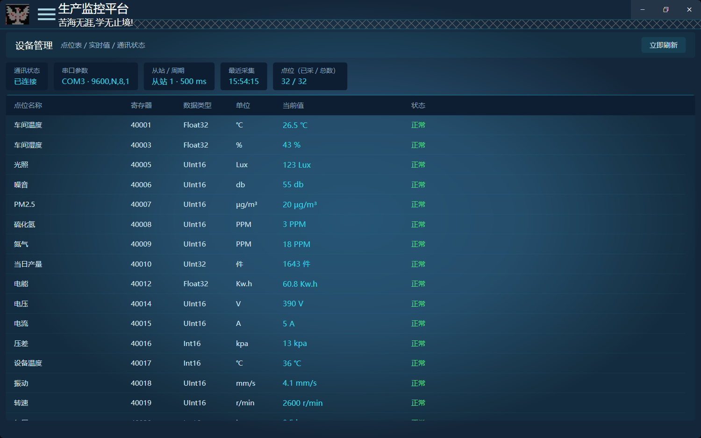
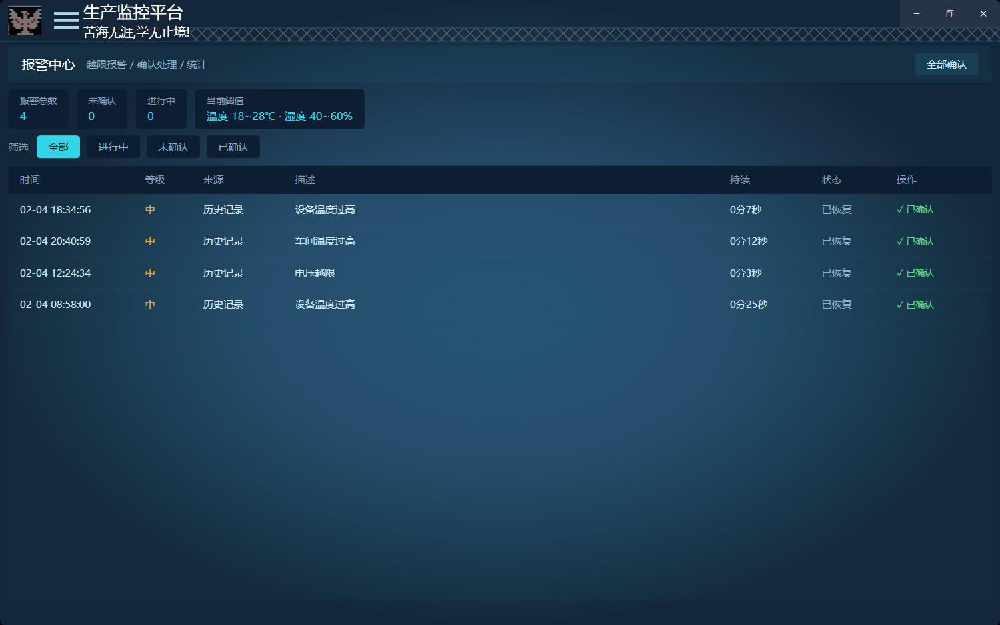

# DeviceMonitor · 生产监控平台

一个基于 **WPF + CommunityToolkit.Mvvm + Modbus RTU + SQLite** 的车间生产监控上位机。
包含登录鉴权、总览大屏、车间下钻、设备点位、阈值报警、报表统计与通讯配置，采集数据落到本地 SQLite。



| 车间详情（逐台机） | 数据报表（SQLite 聚合） |
|---|---|
|  |  |

| 登录 | 设备管理 | 报警中心 |
|---|---|---|
|  |  |  |

---

## 功能

| 模块 | 内容 |
|---|---|
| 登录 | 独立登录窗、PBKDF2-SHA256（10 万次迭代 + 每用户盐）、失败 5 次锁 5 分钟、按角色过滤菜单 |
| 总览大屏 | 环境 7 项 / 设备 8 项 / 四车间统计 / 产能柱状 / 质量折线 / 异常比例环图 / 报警记录 / 人力 |
| 车间详情 | 点车间卡 `[详情]` 进入，逐台机显示状态、计划/完成、进度环；可按作业中/等待/故障/停机筛选 |
| 设备管理 | 32 个 Modbus 点位的实时值、通讯状态、串口参数、最近采集时间 |
| 报警中心 | 阈值引擎（温度/湿度/PM2.5/硫化氢）自动开单与恢复、确认处理、按状态筛选、落库 |
| 数据报表 | 当日产量与不良按小时做差聚合、KPI 汇总、导出 CSV（含原始采集数据导出） |
| 系统设置 | 通讯参数、采集点位表（可增删）、环境阈值，参数校验后保存为 JSON |

## 技术栈

- .NET 8 / WPF（`net8.0-windows`）
- CommunityToolkit.Mvvm 8.4.2（`[ObservableProperty]` / `[RelayCommand]`）
- MaterialDesignThemes 4.9.0、LiveCharts.Wpf 0.9.7
- NModbus4 2.1.0 + System.IO.Ports 8.0.0（Modbus RTU 主站）
- Microsoft.Extensions.DependencyInjection 11.0.0
- Microsoft.EntityFrameworkCore.Sqlite 8.0.11（采集落库）

## 架构

```
Views (XAML)  ──DataTemplate 按 ViewModel 类型定位──  ViewModels
                                                        │
                                          ┌─────────────┼─────────────┐
                                   PlcPollingService  IDataStore   ISettingsService
                                          │                 │             │
                                    IPlcClient        SQLite(EF)     settings.json
                                          │
                              ┌───────────┴───────────┐
                    ModbusRtuPlcClient        SimulatedPlcClient
```

### 数据流

```
PLC(Modbus RTU) ──500ms 轮询──> PlcPollingService.Latest / .Machines
                                        │
                          200ms DispatcherTimer 批量推给 ViewModel
                                        │
                                    界面刷新
                                        │
                        每 5 秒一批 ──> SQLite Readings（保留 7 天）
```

### 几个关键取舍

| 决策 | 原因 |
|---|---|
| 采集 500ms，落库 5 秒一批 | 32 点位 × 500ms = 64 行/秒 ≈ 550 万行/天，SQLite 直接写会拖死采集线程 |
| `SemaphoreSlim(1,1)` 串行化 | Modbus RTU 帧没有请求 ID，且 `SerialPort`/`IModbusMaster` 非线程安全；RS-485 是半双工 |
| 读取超时 350ms < 采集周期 500ms | 否则一次读失败会把采集线程拖过一个周期（设置页会校验这条） |
| 机台块每 3 个周期读一次 | 735 个寄存器全读会挤爆串口，按 40 台（120 寄存器）分块 |
| 整块读越界则降级逐点读 | 从站容量不足时至少能拿到范围内的点位，而不是整块丢弃 |
| 界面批量刷新而非逐点刷新 | 跨线程逐属性刷新会把 UI 线程压死 |

## 快速开始

### 1. 准备 Modbus 从站（无硬件时）

用 **虚拟串口对**（如 VSPD：COM3 ↔ COM4）+ **Modbus Slave** 工具：

- 从站连 COM4，Slave ID = 1，Function = 03 Holding Registers
- `Setup → Slave Definition → Quantity` 设为 **800**（第三批机台点位到 0 基 735）

### 2. 灌入模拟数据

```powershell
tools\Seed\bin\Debug\net8.0\Seed.exe COM3 1
```

- 0–19：环境 / 设备点位
- 20–37：四车间统计 + 不良计数
- 100–735：四车间机台级（状态/计划/完成）

### 3. 运行

```powershell
dotnet build DeviceMonitor.sln
DeviceMonitor\bin\Debug\net8.0-windows\DeviceMonitor.exe
```

默认账号：

| 账号 | 密码 | 角色 |
|---|---|---|
| `admin` | `admin123` | 管理员（可进系统设置） |
| `operator` | `123456` | 操作员（菜单隐藏系统设置） |

首次运行自动建库并 seed 账号：`%LOCALAPPDATA%\DeviceMonitor\data\device.db`

## 目录结构

```
DeviceMonitor\
├─ Data\          AppDbContext、DbBootstrapper（建库 + 账号 seed）
├─ Models\        领域模型 + 配置模型（AppSettings / PlcPoint / MachineBlock）
├─ PlcClient\     IPlcClient、ModbusRtuPlcClient、PlcValue（解码）
├─ Services\      采集、落库、鉴权、配置、密码哈希
├─ ViewModels\    各页面 VM（CommunityToolkit.Mvvm）
├─ Views\         各页面 XAML + 登录窗
├─ StylesDic\     按钮等共用样式
└─ Resource\      字体与图片
```

## 已知限制

1. **累计计数器跨天归零**：当天产量若在 0 点清零，第一个小时的差值为负，已归 0 保护，但会丢一次数据；真实项目应在 0 点写基准值。
2. **报表只有小时粒度**：目前按「同小时最后一个值 − 第一个值」聚合，PLC 中途重启导致计数器回退时该小时会判 0。
3. 产能柱状图、质量折线、异常比例环图仍是静态示例（页面已标注「示例」）。
4. 报警阈值只做了 4 条规则，未做去抖/延时确认。

## 开发说明

本项目在 AI 编码助手辅助下完成界面与工程骨架，核心采集链路（`PlcPollingService`、`ModbusRtuPlcClient`、`PlcValue` 解码、按小时聚合）经过逐行走读与手工改造。
如需将此项目写入简历，建议只声明自己能讲清楚、能现场修改的部分。

## 参考

界面风格参考了公开教程项目 *ProductMonitor（生产监控平台）*，本仓库仅保留样式与布局思路，数据层、通讯层、导航与持久化均为重写实现。
